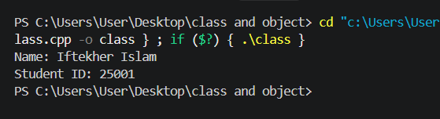
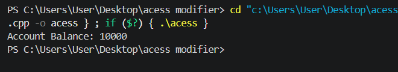
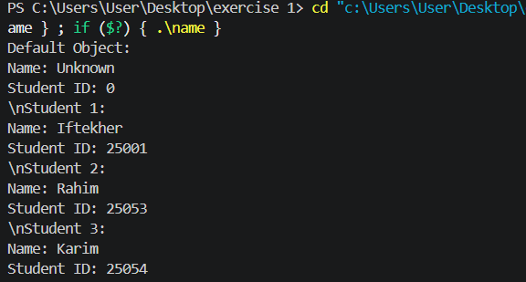

# ICT 2106 – Object-Oriented Programming Lab
## Assignment: Exploring the Fundamentals of OOP

## Program Output Screenshots

### 1. Classes and Objects


### 2. Access Modifiers


### 3. Constructors


---

## Student Details

| Field | Details |
|---|---|
| **Student Name** | Iftekher Islam |
| **Student ID** | 25001 |
| **Course** | ICT 2106 – Object-Oriented Programming Lab |
| **Assignment Type** | Individual |
| **Language** | C++ |
| **Topics** | Classes, Objects, Access Modifiers, Constructors and Encapsulation |

## Assignment Overview
This repository contains the solutions for the OOP lab assignment. The answers to the Tasks for the three concepts are written as comments inside the C++ programs, and the two exercises are implemented as separate C++ programs. Together they show how a class bundles data and behaviour, how access modifiers protect data, and how constructors initialise objects.

## Table of Contents
1. [Repository Structure](#repository-structure)
2. [Concepts Covered](#concepts-covered)
3. [Exercises](#exercises)
4. [How to Compile and Run](#how-to-compile-and-run)
5. [Sample Output](#sample-output)
6. [Key OOP Terms](#key-oop-terms)
7. [Learning Outcomes](#learning-outcomes)
8. [Notes](#notes)

## Repository Structure
```text
OOP-Fundamentals-Assignment/
├── Concepts/
│   ├── 01_Classes_and_Objects.cpp
│   ├── 02_Access_Modifiers.cpp
│   └── 03_Constructors.cpp
├── Exercises/
│   ├── 01_Student_Information_Management.cpp
│   └── 02_Bank_Account_Management.cpp
├── Report/
│   └── OOP-Fundamentals-Assignment.pdf
├── screenshots/
│   ├── 01_classes_and_objects_output.png
│   ├── 02_access_modifiers_output.png
│   └── 03_constructors_output.png
└── README.md
```

## Concepts Covered

| # | Concept | File | Summary |
|---|---|---|---|
| 1 | **Classes and Objects** | `Concepts/01_Classes_and_Objects.cpp` | A class is a blueprint, and an object is an instance of a class. Public members are accessed with the dot (`.`) operator. |
| 2 | **Access Modifiers** | `Concepts/02_Access_Modifiers.cpp` | `public`, `private` and `protected` control access to class members. A `private` member is reachable only through public getters/setters. |
| 3 | **Constructors** | `Concepts/03_Constructors.cpp` | Constructors initialise objects when they are created. Both a default and a parameterized constructor are shown. |

### 1. Classes and Objects
- `Student` is the class; `s1` is an object of it.
- `name` and `studentID` are data members, and `displayInfo()` is a member function.
- The object reads and writes public members using the dot operator (`s1.name`).

### 2. Access Modifiers
- `balance` in `BankAccount` is `private`, so `account.balance = 10000;` causes a compilation error.
- `setBalance()` and `getBalance()` are `public`, and give controlled access to the private value.
- This is the first look at **encapsulation**: data hidden inside the class, exposed only through safe functions.

### 3. Constructors
- The **default constructor** `Student()` sets `name = "Unknown"` and `studentID = 0`.
- The **parameterized constructor** `Student(string, int)` stores the values passed at creation.
- Each object keeps its own separate data.

## Exercises

| Exercise | File | Description |
|---|---|---|
| **01 – Student Information Management** | `Exercises/01_Student_Information_Management.cpp` | Stores and displays ID, name, department and semester for three students using private data members and public setter/display functions. |
| **02 – Bank Account Management** | `Exercises/02_Bank_Account_Management.cpp` | Demonstrates deposits, withdrawals, balance checking and encapsulation using two independent accounts. |

**Exercise 02 validation rules**
- A negative opening balance is stored as `0`.
- Deposits and withdrawals must be greater than zero.
- A withdrawal larger than the current balance is rejected with `Insufficient balance.`

## How to Compile and Run
You need a C++ compiler such as GCC (`g++`) or MinGW. Open a terminal in the repository folder, then run:

```bash
g++ Concepts/01_Classes_and_Objects.cpp -o concept1
./concept1

g++ Concepts/02_Access_Modifiers.cpp -o concept2
./concept2

g++ Concepts/03_Constructors.cpp -o concept3
./concept3

g++ Exercises/01_Student_Information_Management.cpp -o exercise1
./exercise1

g++ Exercises/02_Bank_Account_Management.cpp -o exercise2
./exercise2
```

On Windows (PowerShell), run the executable with `.\concept1` instead of `./concept1`.

## Sample Output

**Exercise 01 – Student Information Management**
```text
Student 1:
ID: 25052
Name: Abu Bakar
Department: CSE
Semester: 1
\nStudent 2:
ID: 25053
Name: Rahim
Department: EEE
Semester: 2
\nStudent 3:
ID: 25054
Name: Karim
Department: ICT
Semester: 3
```

**Exercise 02 – Bank Account Management**
```text
Account 1 Transactions:
Deposit successful.
Withdrawal successful.
\nAccount 2 Transactions:
Deposit successful.
Insufficient balance.
\nAccount 1 Information:
Account Number: 101
Account Holder: Abu Bakar
Balance: 6000
\nAccount 2 Information:
Account Number: 102
Account Holder: Rahim
Balance: 4500
```

## Key OOP Terms

| Term | Meaning |
|---|---|
| **Class** | A blueprint that defines data members and member functions. |
| **Object** | A real instance created from a class. |
| **Data member** | A variable declared inside a class. |
| **Member function** | A function declared inside a class. |
| **Access modifier** | `public`, `private` or `protected`: controls who can use a member. |
| **Constructor** | A special function that runs automatically when an object is created. |
| **Encapsulation** | Keeping data private and exposing it only through public functions. |

## Learning Outcomes
After completing this assignment, I practiced:
- creating classes and objects and accessing members with the dot operator,
- using `public` and `private` access modifiers to protect data,
- writing default and parameterized constructors,
- applying encapsulation with getters, setters and input validation in simple C++ programs.

---
## Notes
- In `02_Access_Modifiers.cpp`, the direct private-member access line is kept commented out so that the program can compile. Uncomment it to observe the expected compilation error.
- The final PDF report goes in the `Report/` folder.
